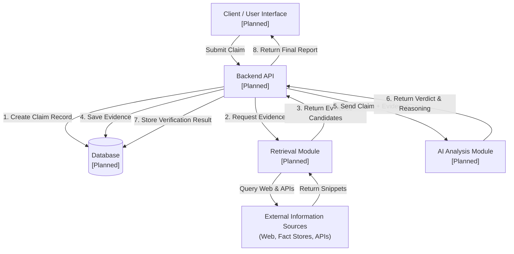

# TrueMark System Architecture

> **Implementation Status: Planned / Not Yet Implemented**
> *Note: This document details the planned architectural design for the TrueMark project. None of the database, retrieval, API, or AI components are implemented yet.*

---

## 1. Overview & Objective

**TrueMark** is an intelligent claim-verification platform designed to assess the truthfulness of factual statements using multi-source supporting evidence and AI-driven reasoning.

The system ingests claims, orchestrates retrieval of verifiable evidence from authoritative sources, synthesizes the findings through an AI analysis module, and produces structured verdicts accompanied by transparent justifications and source citations.

---

## 2. Planned Architecture Diagram

---

## 3. Core Component Responsibilities

### 3.1 Database Module (`database/`)
* **Status**: **Planned (Not yet implemented)**
* **Planned Responsibilities**:
  * **Relational Schema Management**: Provide structured storage using SQLAlchemy ORM and Alembic migrations.
  * **Entity Lifecycles**:
    * **Claims**: Storing user submissions, unique identifiers, timestamps, and processing states (`PENDING`, `RETRIEVING`, `ANALYZING`, `VERIFIED`, `FAILED`).
    * **Evidence**: Storing raw passages, source titles, URLs, publication dates, and relevance scores.
    * **Verification Results**: Storing verdicts (`TRUE`, `FALSE`, `PARTIALLY_TRUE`, `UNVERIFIED`), confidence metrics, and structured explanations.
  * **Connection Lifecycle**: Manage connection pooling, transaction isolation, and session dependency injection for API routes.

### 3.2 Retrieval Module (`retrieval/`)
* **Status**: **Planned (Not yet implemented)**
* **Planned Responsibilities**:
  * **Evidence Query Generation**: Transform submitted claims into targeted search queries.
  * **Source Interrogation**: Fetch real-time web search results, fact-checking databases, and knowledge repositories.
  * **Parsing & Extraction**: Extract clean textual passages and metadata from HTML/JSON responses while stripping boilerplate.
  * **Filtering & Deduplication**: Score relevance and remove redundant or low-credibility sources before passing candidate evidence downstream.

### 3.3 Backend API (`api/` or Application Service)
* **Status**: **Planned (Not yet implemented)**
* **Planned Responsibilities**:
  * **Request Handling**: Provide RESTful endpoints for claim submission, verification polling, and historical lookup.
  * **Input Validation**: Validate and sanitize claim text and parameters using Pydantic schemas.
  * **Workflow Orchestration**: Coordinate the pipeline between Database, Retrieval, and AI modules.
  * **Error Handling & Resilience**: Handle rate limits, timeouts, and retrieval errors gracefully with meaningful status codes.

### 3.4 AI Analysis Module
* **Status**: **Planned (Not yet implemented)**
* **Planned Responsibilities**:
  * **Context Synthesis**: Combine the input claim and retrieved evidence snippets into structured verification prompts.
  * **Reasoning & NLI**: Perform natural language inference to detect entailment, contradiction, or neutral stance across multiple evidence items.
  * **Verdict Generation**: Assign calibrated verdict classifications (True / False / Partially True / Unverified) with confidence scores.
  * **Transparent Justification**: Produce structured, human-readable explanations citing specific evidence sources.

---

## 4. Component Status Matrix

| Component | Directory / Path | Planned Responsibility | Status |
| :--- | :--- | :--- | :--- |
| **Database** | `database/` | Models, connection pooling, persistence | ⚠️ Planned (Not yet implemented) |
| **Retrieval** | `retrieval/` | Evidence search, source extraction, filtering | ⚠️ Planned (Not yet implemented) |
| **Backend API** | `api/` (Future) | REST endpoints, request routing, orchestration | ⚠️ Planned (Not yet implemented) |
| **AI Analysis** | `ai/` (Future) | Fact verification reasoning, verdict generation | ⚠️ Planned (Not yet implemented) |
| **Test Suite** | `tests/` | Unit, integration, and contract tests | ⚠️ Initialized (Scaffolding only) |

---

## 5. Security & Configuration Principles
* **Zero Secrets in Code**: All API keys, connection strings, and credentials must strictly be loaded from environment variables (`.env`).
* **Safe Defaults**: Local development defaults to isolated SQLite configurations (`sqlite:///./truemark.db`).
* **Input Sanitization**: All claims and external search snippets will be treated as untrusted data.
